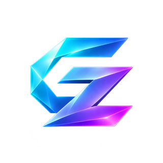
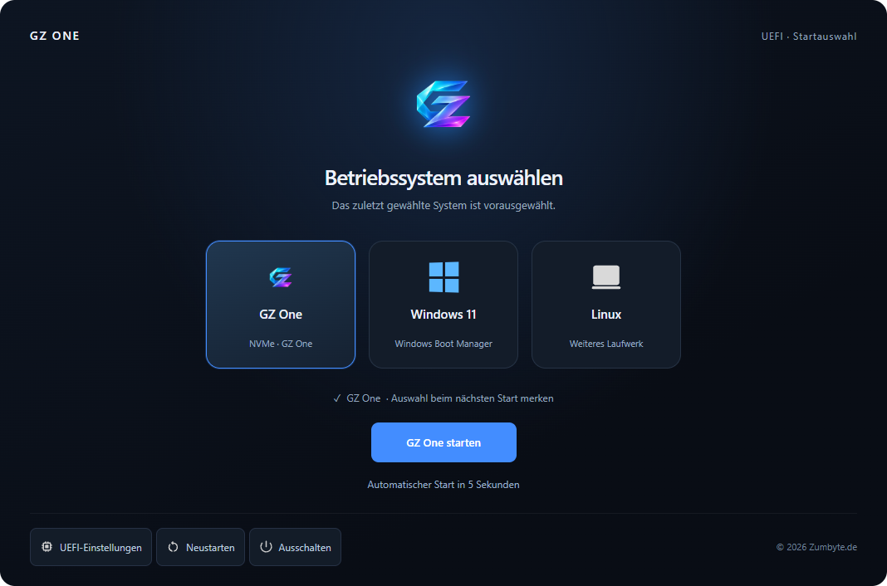
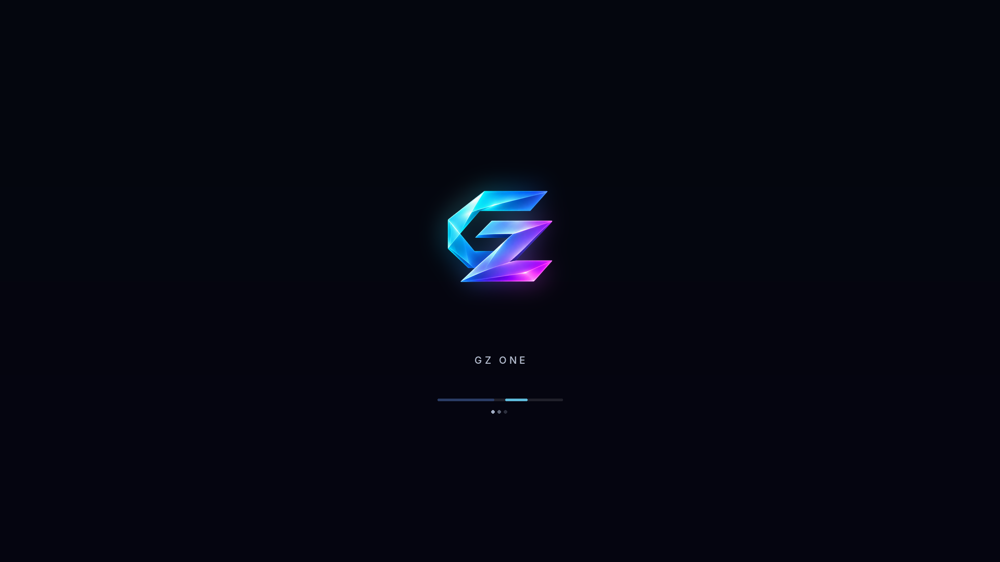
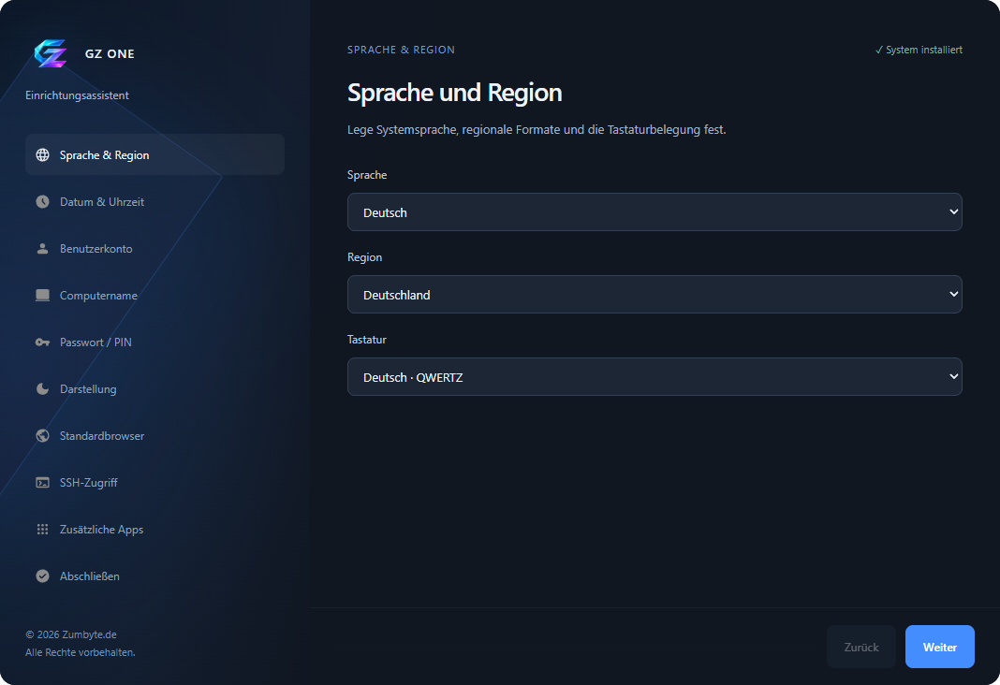

<h1 align="center">GZ One</h1>

Dein System. Dein nächstes Level.

<a href="https://github.com/ZUMBYTE-AppSolution/gzone/releases">Herunterladen</a> · <a href="CHANGELOG.md">Änderungen</a> · <a href="https://www.zumbyte.de/support/">Support</a>

  

**GZ One** ist ein Gaming-Betriebssystem, das sich anfühlt wie aus einem Guss: ruhig, hochwertig und klar aufgebaut. Menüleiste oben, Dock unten, einheitliche Fenster und Symbole, dazu Steam, Gamescope und alles, was Spiele unter Linux brauchen. Von der Startauswahl über den Bootscreen bis zum Desktop folgt jedes Element demselben Design.

Die Grundlage bildet **Fedora 45** mit KDE Plasma 6 und Wayland. GZ One wird als **bootc-Image** ausgeliefert: Updates werden als Ganzes eingespielt und lassen sich mit einem Neustart vollständig zurücknehmen.

| Dein Rechner | Passendes Installationsmedium |
| --- | --- |
| PC mit x86_64-Prozessor, UEFI | ISO-Installer · folgt mit der ersten Vorschau |
| PC mit NVIDIA-Grafikkarte | eigene NVIDIA-Ausgabe · geplant |

**Aktuell gibt es noch keinen Download.** GZ One wird von Grund auf neu aufgebaut. Installationsmedien erscheinen ausschließlich als eigene Veröffentlichungen unter [Releases](https://github.com/ZUMBYTE-AppSolution/gzone/releases).

## Stand: Neuaufbau

Die frühere Entwicklungsvorschau auf Basis von Hyprland ist eingestellt. GZ One entsteht jetzt neu als bootc-Image auf Fedora Kinoite. Jeder Entwicklungsschritt wird in einer Test-VM gebootet und geprüft, vom Bootloader bis zum Desktop. Die Screenshots auf dieser Seite folgen, sobald die ersten Stände laufen.

## 🖼️ Einblicke

Die folgenden Bilder sind **Gestaltungsentwürfe**, keine Aufnahmen des laufenden Systems.

| Bootscreen | Einrichtungsassistent |
| --- | --- |
|  |  |

## 🆕 Aktuelles Changelog

- Neuaufbau als bootc-Image auf Fedora 45 Kinoite gestartet.
- Entwicklungsumgebung mit Live-Vorschau in einer Test-VM eingerichtet.

[Alle Änderungen](CHANGELOG.md).

## ✨ Was GZ One mitbringt

Diese Funktionen sind geplant und entstehen Schritt für Schritt.

| Bereich | Das bietet dir GZ One |
| --- | --- |
| **Startauswahl** | Eigene UEFI-Startauswahl „GZ Boot“ mit Karten für GZ One, Windows und weitere Systeme. Merkt sich die letzte Wahl, startet nach einem Countdown und führt direkt in die UEFI-Einstellungen. |
| **Bootscreen** | Ruhiger Start mit pulsierendem Logo und Fortschrittsanzeige. Die Passwortabfrage für verschlüsselte Laufwerke erscheint im selben Stil. |
| **Desktop** | Menüleiste mit globalem Menü, Dock, Kontrollzentrum, Übersicht aller Fenster und Schnellsuche. Hell, dunkel oder automatisch, mit einer einheitlichen Akzentfarbe. |
| **Symbole und Schrift** | Ein durchgehender Symbolsatz auf Basis von Material Symbols und die Schrift Inter. Auch Apps anderer Anbieter werden passend eingefärbt. |
| **Gaming** | Steam, Gamescope, MangoHud, GameMode und 32-Bit-Vulkan. Optionaler Spielmodus mit Steam Big Picture direkt bei der Anmeldung. |
| **Einrichtung** | Vollbild-Assistent beim ersten Start: Sprache und Region, Tastatur, Netzwerk, Benutzerkonto, Passwort oder PIN, Darstellung und Datenschutz. |
| **Eigene Apps** | Softwareupdate, Gaming-Zentrale, Systeminfo, Schlüsselbund und App-Store, alle im selben Design. |

## 🔐 Sicherheit

- **Signierte Updates:** Jedes Systemabbild ist signiert. GZ One installiert nur Abbilder mit gültiger Signatur.
- **Secure Boot:** Startauswahl und Kernel laufen mit aktivem Secure Boot.
- **Verschlüsselung:** Laufwerksverschlüsselung mit LUKS2, Entsperren über TPM2 und optionaler PIN, dazu ein Wiederherstellungsschlüssel.
- **Rechte im Blick:** Kamera, Mikrofon, Bildschirm, Dateien und USB-Geräte nur nach deiner Freigabe. Alles gesammelt unter **Datenschutz & Sicherheit**.

## 📦 Installation und erster Start

1. Das Installationsmedium unter [Releases](https://github.com/ZUMBYTE-AppSolution/gzone/releases) herunterladen, sobald es verfügbar ist.
2. Auf einen USB-Stick schreiben und den PC davon im UEFI-Modus starten.
3. Ziel-Laufwerk und Verschlüsselung wählen und die Installation bestätigen.
4. Nach dem Neustart führt dich der Einrichtungsassistent durch die ersten Einstellungen.

**Voraussetzungen:** 64-Bit-PC (x86_64) mit UEFI, mindestens 8 GB Arbeitsspeicher und 64 GB Speicherplatz. Einzelne Spiele können Linux wegen ihrer Anti-Cheat- oder Kopierschutzvorgaben ausschließen.

## 🔄 Updates und Rückkehr

GZ One aktualisiert sich als vollständiges Systemabbild. Das neue Abbild wird im Hintergrund vorbereitet und beim nächsten Neustart aktiv. Läuft etwas nicht wie erwartet, startest du mit einem Klick wieder die vorherige Version. Persönliche Dateien bleiben dabei unverändert.

## 💬 Hilfe, Lizenz und Kontakt

[Fehler melden](https://github.com/ZUMBYTE-AppSolution/gzone/issues) · [Support](https://www.zumbyte.de/support/)

GZ One basiert auf Fedora und weiteren freien Komponenten, die unter ihren eigenen Lizenzen stehen. Name, Logo und Gestaltung von GZ One gehören **Zumbyte - AppSolution**, siehe [NOTICE](NOTICE.md). Dieses Repository enthält Produktinformationen und Downloads. Der Quellcode ist nicht öffentlich.

**Zumbyte - AppSolution | [www.zumbyte.de](https://www.zumbyte.de/)**
© 2026 Zumbyte - AppSolution · [Datenschutz](https://www.zumbyte.de/datenschutz/) · [Impressum](https://www.zumbyte.de/impressum/)
